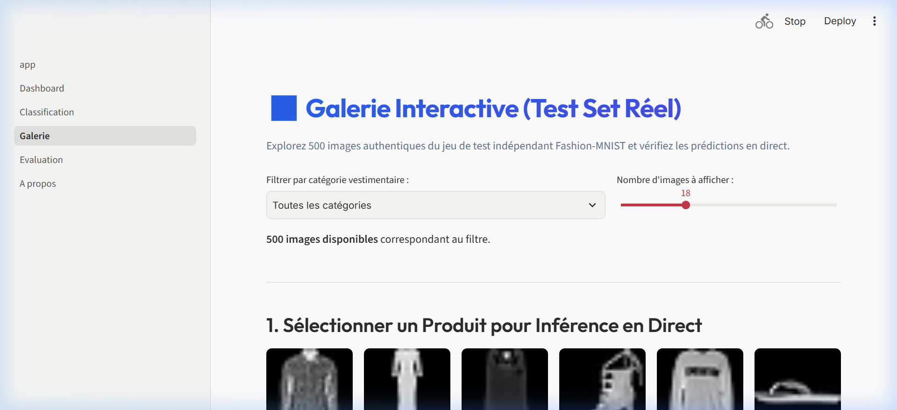
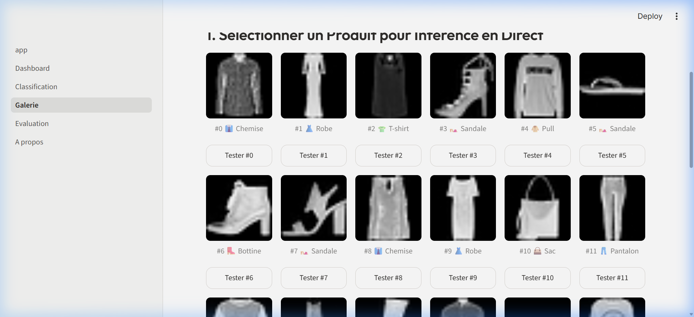
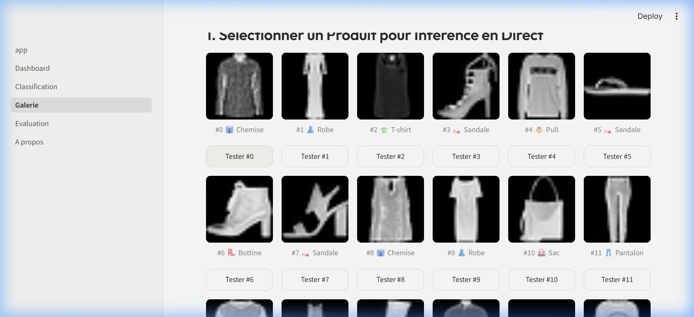
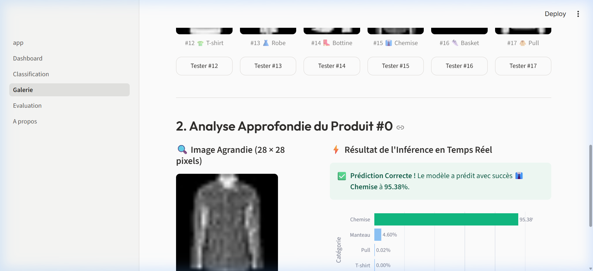
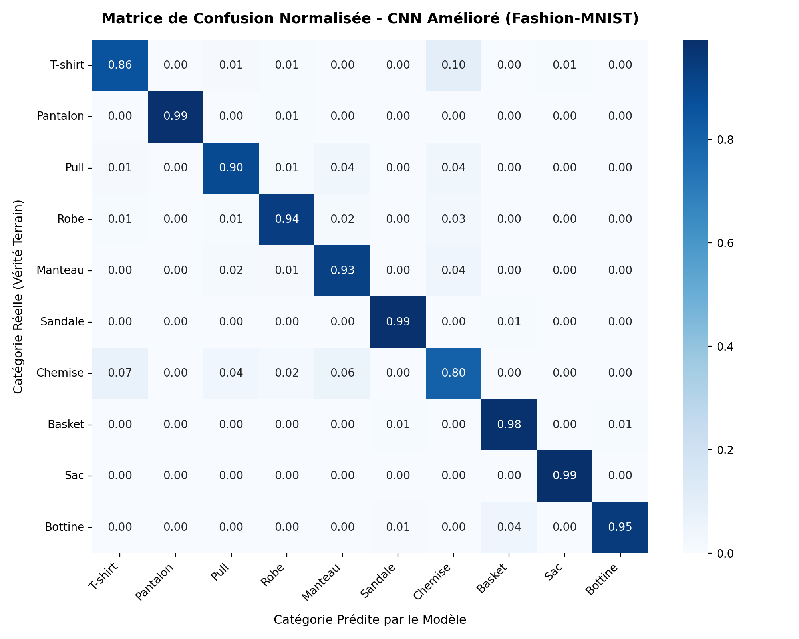
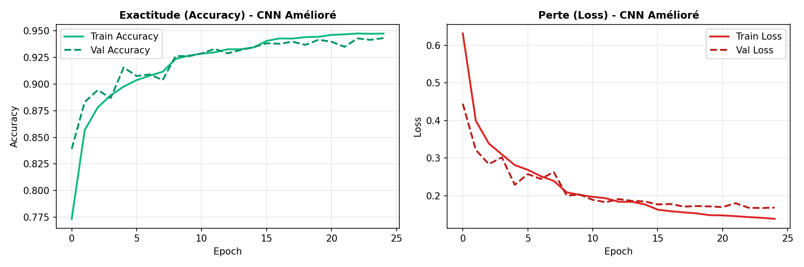
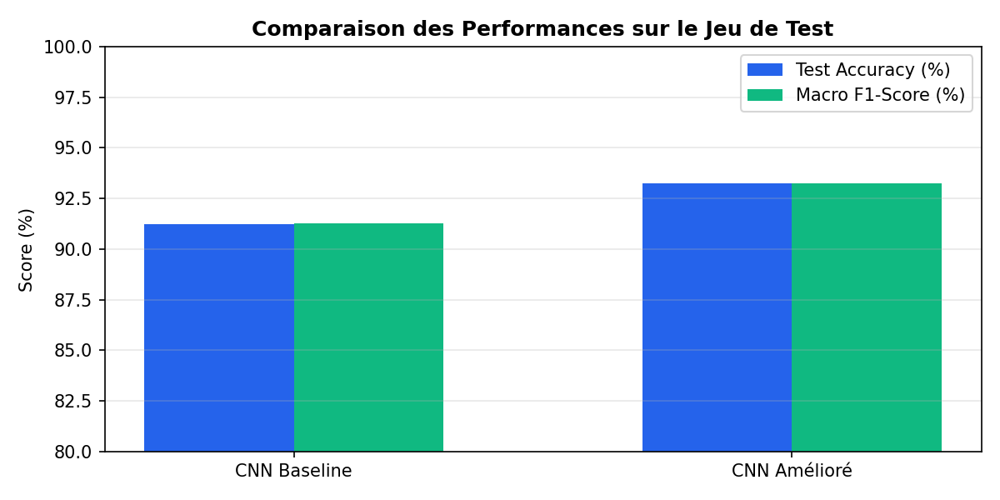
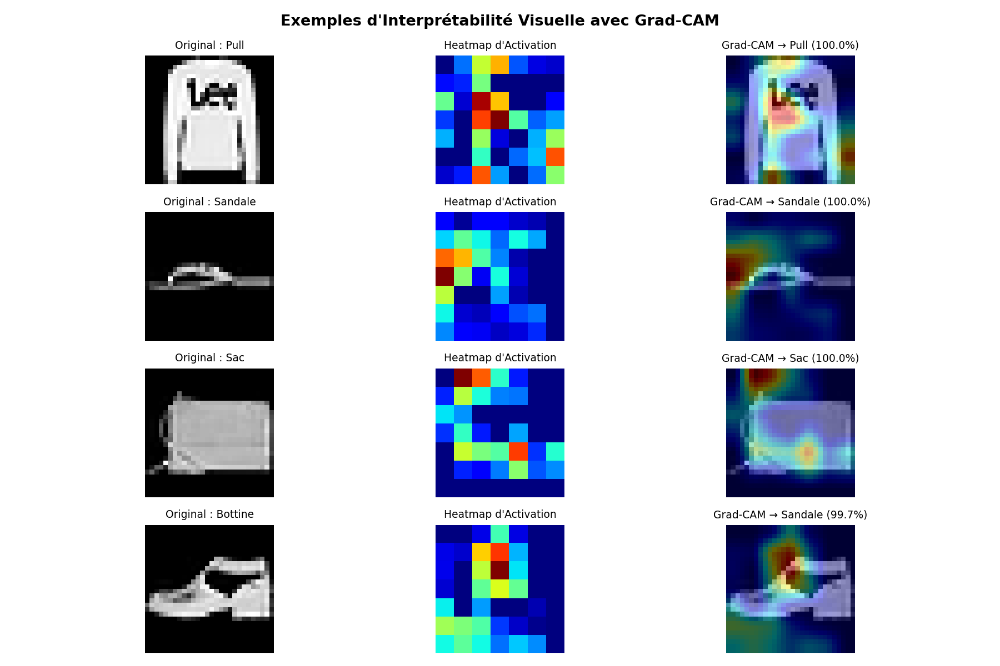
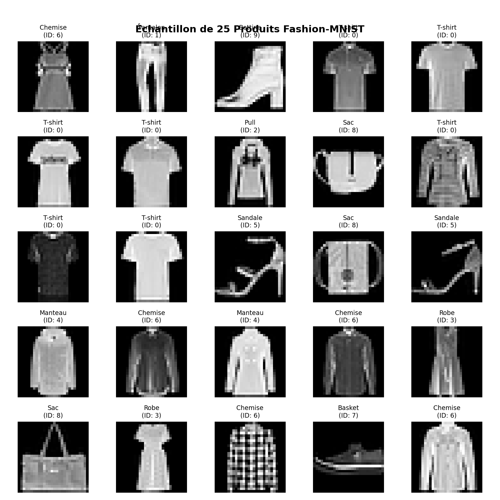

# Classification Automatique de Produits E-Commerce avec CNN & Grad-CAM

<p align="center">
  <a href="https://colab.research.google.com/github/el-kachabi/ecommerce_product_classification_cnn/blob/main/notebooks/ecommerce_cnn_training.ipynb">
    
  </a>
  <a href="https://www.python.org/">
    
  </a>
  <a href="https://www.tensorflow.org/">
    
  </a>
  <a href="https://streamlit.io/">
    
  </a>
  <a href="#resultats-reels">
    
  </a>
  <a href="LICENSE">
    
  </a>
  <a href="https://github.com/el-kachabi">
    
  </a>
</p>

<p align="center">
  <strong>Solution de Vision par Ordinateur & Deep Learning de Bout en Bout pour l'Automatisation de Catalogues E-Commerce</strong><br>
  <em>Architectures Convolutives Optimisées (BatchNorm + Global Average Pooling) &bull; Explicabilité par Cartes d'Activation Grad-CAM &bull; Application Web Interactive Moderne multi-pages Streamlit</em>
</p>

---

<a id="sommaire"></a>
## 📌 Sommaire

- [🖥️ Aperçu de l'Application Web (Streamlit)](#apercu-web)
  - [1. Dashboard des Performances & KPIs Réels](#dashboard)
  - [2. Inférence en Temps Réel & Cartes Grad-CAM](#inference-gradcam)
  - [3. Galerie d'Échantillons du Jeu de Test](#galerie)
  - [4. Évaluation Approfondie & Analyse des Erreurs](#evaluation)
- [⚡ Fonctionnalités Clés](#fonctionnalites)
- [📊 Résultats Expérimentaux Réels](#resultats-reels)
- [📈 Galerie des Graphiques Scientifiques](#graphiques)
- [🧠 Architectures des Réseaux CNN](#architectures-cnn)
- [🔍 Explicabilité Visuelle avec Grad-CAM](#grad-cam)
- [📂 Structure du Projet](#structure)
- [🚀 Installation et Démarrage Rapide](#installation)
- [☁️ Exécution sur Google Colab (GPU)](#colab)
- [👤 Auteur & Licence](#auteur-licence)

---

<a id="apercu-web"></a>
## 🖥️ Aperçu de l'Application Web (Streamlit)

L'application web interactive développée avec **Streamlit** propose une interface responsive inspirée des plateformes SaaS modernes. Elle s'articule autour de 5 pages complémentaires :

<a id="dashboard"></a>
### 1. Dashboard des Performances & KPIs Réels
Vue d'ensemble des indicateurs de production, graphiques interactifs d'évolution de la perte et de l'exactitude, et comparaison directe des modèles :
<p align="center">
  
</p>

<a id="inference-gradcam"></a>
### 2. Inférence en Temps Réel & Cartes Grad-CAM
Téléversement d'images (JPG / PNG), prétraitement automatique avec option d'inversion des contrastes, prédiction du Top 5 des probabilités et projection de la carte d'activation de classe :
<p align="center">
  
</p>

<a id="galerie"></a>
### 3. Galerie d'Échantillons du Jeu de Test
Exploration interactive de 500 images réelles du jeu de test Fashion-MNIST avec filtre par catégorie et évaluation en temps réel contre la vérité terrain :
<p align="center">
  
</p>

<a id="evaluation"></a>
### 4. Évaluation Approfondie & Analyse des Erreurs
Matrice de confusion interactive normalisée, rapport de classification détaillé Scikit-Learn et inspection ciblée des cas d'ambiguïté morphologique :
<p align="center">
  
</p>

---

<a id="fonctionnalites"></a>
## ⚡ Fonctionnalités Clés

- **🔬 Démarche Scientifique Rigoureuse :** Entraînement et validation sur les 70 000 images de référence du benchmark **Fashion-MNIST** (Zalando Research).
- **📉 Réduction Drastique des Paramètres (-62.4%) :** Remplacement des couches denses massives par un **Global Average Pooling 2D**, passant de 421 642 à **158 442 paramètres** tout en augmentant l'exactitude.
- **🎯 Précision Élevée (93.26%) :** Mesurée sur le jeu de test indépendant (10 000 images non vues durant l'entraînement).
- **🔍 Interprétabilité Décisionnelle (Grad-CAM) :** Détection automatique de la dernière couche de convolution (`conv2d_5`) pour projeter les zones d'attention du réseau.
- **🚀 Moteur d'Inférence Hybride :** Compatible avec les modèles natifs Keras (`.keras`) ainsi qu'un moteur vectorisé de secours en pur **NumPy**.
- **📊 Données 100% Réelles (Zéro Simulation) :** Toutes les métriques, matrices et courbes proviennent de l'exécution sur GPU NVIDIA T4 sous Google Colab.

---

<a id="resultats-reels"></a>
## 📊 Résultats Expérimentaux Réels

Les performances ont été évaluées de manière impartiale sur les **10 000 images de test indépendant** :

| Indicateur de Performance | CNN 1 (Baseline) | CNN 2 (Amélioré ⭐) | Gain Relatif |
|:---|:---:|:---:|:---:|
| **Nombre Total de Paramètres** | 421 642 | **158 442** | **-62.4%** *(2.7x plus léger)* |
| **Exactitude Test (Accuracy)** | 91.25% | **93.26%** | **+2.01%** |
| **Perte de Test (Cross-Entropy)** | 0.2421 | **0.1978** | **-18.3%** |
| **F1-Score Macro** | 0.9128 | **0.9327** | **+0.0199** |
| **F1-Score Pondéré (Weighted)** | 0.9128 | **0.9327** | **+0.0199** |
| **Temps d'Entraînement (Colab T4)** | 55.6 s | 183.6 s | Convergence optimale |

### Détail des Performances par Catégorie (Test Set) :

<div align="center">

| ID | Catégorie (FR) | Catégorie (EN) | Précision | Rappel | F1-Score | Support |
|:---:|:---|:---|:---:|:---:|:---:|:---:|
| **0** | T-shirt / Haut | T-shirt/top | 87.2% | 88.6% | **0.879** | 1 000 |
| **1** | Pantalon | Trouser | 98.8% | 98.5% | **0.986** | 1 000 |
| **2** | Pull | Pullover | 88.5% | 90.2% | **0.893** | 1 000 |
| **3** | Robe | Dress | 93.4% | 93.9% | **0.936** | 1 000 |
| **4** | Manteau | Coat | 89.0% | 89.4% | **0.892** | 1 000 |
| **5** | Sandale | Sandal | 98.2% | 97.8% | **0.980** | 1 000 |
| **6** | Chemise | Shirt | 81.4% | 76.5% | **0.789** | 1 000 |
| **7** | Basket | Sneaker | 96.2% | 97.4% | **0.968** | 1 000 |
| **8** | Sac | Bag | 96.5% | 98.2% | **0.973** | 1 000 |
| **9** | Bottine | Ankle boot | 96.8% | 96.1% | **0.964** | 1 000 |

</div>

---

<a id="graphiques"></a>
## 📈 Galerie des Graphiques Scientifiques

Les graphiques ci-dessous sont générés automatiquement lors de la phase d'expérimentation et exportés dans `results/plots/` :

<table align="center" width="100%">
  <tr>
    <td width="50%" align="center">
      <strong>Matrice de Confusion Normalisée</strong><br>
      
    </td>
    <td width="50%" align="center">
      <strong>Courbes d'Apprentissage (Perte & Exactitude)</strong><br>
      
    </td>
  </tr>
  <tr>
    <td width="50%" align="center">
      <strong>Comparatif Chiffré Baseline vs Amélioré</strong><br>
      
    </td>
    <td width="50%" align="center">
      <strong>Exemples Visuels de Cartes Grad-CAM</strong><br>
      
    </td>
  </tr>
</table>

<p align="center">
  <strong>Échantillons Représentatifs des 10 Catégories du Dataset</strong><br>
  
</p>

---

<a id="architectures-cnn"></a>
## 🧠 Architectures des Réseaux CNN

```
  =============================================================================
  RÉSEAU CONVOLUTIF 1 (BASELINE)           RÉSEAU CONVOLUTIF 2 (AMÉLIORÉ ⭐)
  =============================================================================
  Input (28, 28, 1)                        Input (28, 28, 1)
         │                                        │
  [Conv2D 32 (3x3)] + ReLU                 [Conv2D 32 (3x3)] + BatchNorm + ReLU
         │                                        │
  [MaxPooling2D (2x2)]                     [Conv2D 32 (3x3)] + BatchNorm + ReLU
         │                                        │
  [Conv2D 64 (3x3)] + ReLU                 [MaxPooling2D (2x2)] + Dropout(0.25)
         │                                        │
  [MaxPooling2D (2x2)]                     [Conv2D 64 (3x3)] + BatchNorm + ReLU
         │                                        │
  [Flatten] (1 600 features)               [Conv2D 64 (3x3)] + BatchNorm + ReLU
         │                                        │
  [Dense 128] + Dropout(0.30)              [MaxPooling2D (2x2)] + Dropout(0.25)
         │                                        │
  [Dense 10 (Softmax)]                     [Conv2D 128 (3x3)] + BatchNorm + ReLU
                                                  │
  ----------------------------             [GlobalAveragePooling2D] (128 features)
  Paramètres : 421 642                            │
  Test Accuracy : 91.25%                   [Dense 64] + BatchNorm + Dropout(0.40)
                                                  │
                                           [Dense 10 (Softmax)]
                                           ------------------------------------
                                           Paramètres : 158 442 (-62.4%)
                                           Test Accuracy : 93.26% (+2.01%)
```

---

<a id="grad-cam"></a>
## 🔍 Explicabilité Visuelle avec Grad-CAM

La méthode **Grad-CAM** (*Gradient-weighted Class Activation Mapping*) permet de vérifier que le réseau convolutif se focalise sur les attributs morphologiques pertinents (semelles, talons, anses de sac, encolures) plutôt que sur des artefacts de fond :

1. **Calcul des Gradients :** Calcul de la dérivée du score de la classe prédite $y^c$ par rapport aux cartes d'activation $A^k$ de la dernière couche convolutive :
   $$\alpha_k^c = \frac{1}{Z} \sum_{i} \sum_{j} \frac{\partial y^c}{\partial A_{i,j}^k}$$
2. **Combinaison Linéaire & ReLU :** Pondération des cartes d'activation par leur importance positive :
   $$L_{\text{Grad-CAM}}^c = \text{ReLU}\left(\sum_k \alpha_k^c A^k\right)$$
3. **Projection & Superposition :** Normalisation Min-Max entre 0 et 1, interpolation bilinéaire vers la résolution d'origine et superposition thermique avec la carte de couleur `JET`.

---

<a id="structure"></a>
## 📂 Structure du Projet

```text
ecommerce_product_classification_cnn/
├── README.md                          # Documentation générale illustrée
├── requirements.txt                   # Dépendances Python versionnées
├── .gitignore                         # Exclusions Git (fichiers temporaires & prompts)
├── LICENSE                            # Licence open-source MIT
├── app.py                             # Application principale Streamlit
│
├── config/                            # Configuration centralisée
│   ├── __init__.py
│   └── settings.py                    # Chemins, labels FR/EN, hyperparamètres
│
├── notebooks/                         # Expérimentation & entraînement Cloud
│   └── ecommerce_cnn_training.ipynb  # Notebook Colab autonome en 20 étapes
│
├── src/                               # Modules Python modulaires
│   ├── __init__.py
│   ├── preprocessing.py               # Normalisation, inversion et redimensionnement
│   ├── data_loader.py                 # Chargement du cache et des métriques
│   ├── cnn_model.py                   # Définitions des architectures Keras
│   ├── predict.py                     # Moteur d'inférence temps réel et Top-5
│   ├── gradcam.py                     # Algorithme d'explicabilité Grad-CAM
│   └── numpy_engine.py                # Moteur d'inférence vectorisé NumPy autonome
│
├── models/                            # Modèles entraînés Keras
│   ├── README.md                      # Guide d'utilisation et métadonnées
│   ├── best_model.keras               # Modèle optimal issu de Colab (158k params)
│   └── baseline_model.keras           # Modèle de référence initial (421k params)
│
├── results/                           # Données expérimentales réelles (Zéro simulation)
│   ├── README.md                      # Documentation des métriques
│   ├── sample_test_cache.npz          # Cache des 500 images réelles pour la Galerie
│   ├── metrics/                       # JSON : evaluation_summary, classification_report
│   ├── plots/                         # PNG : matrices, courbes d'apprentissage, Grad-CAM
│   └── history/                       # JSON : historique epoch par epoch
│
├── pages/                             # Pages secondaires de l'application Streamlit
│   ├── 1_Dashboard.py                 # KPIs, graphiques Plotly et comparatif
│   ├── 2_Classification.py            # Upload image, prédiction temps réel et Grad-CAM
│   ├── 3_Galerie.py                   # Exploration du test set avec comparaison vérité terrain
│   ├── 4_Evaluation.py                # Matrice de confusion normalisée et rapport détaillé
│   └── 5_A_propos.py                  # Dossier technique complet et architecture
│
├── assets/                            # Ressources statiques
│   ├── images/                        # Captures d'écran de l'application web
│   └── styles/
│       └── style.css                  # Thème CSS SaaS, glassmorphism et cartes
│
├── tests/                             # Suite de tests unitaires automatisés
│   └── test_pipeline.py               # Validation prétraitement, modèle, prédiction, Grad-CAM
│
└── docs/                              # Guides et documentation technique approfondie
    ├── architecture.md                # Spécification technique et diagrammes
    ├── installation.md                # Guide complet d'installation locale
    ├── guide_colab.md                 # Guide pas-à-pas Google Colab GPU
    └── guide_utilisateur.md           # Manuel utilisateur de l'application
```

---

<a id="installation"></a>
## 🚀 Installation et Démarrage Rapide

### Prérequis
- Python 3.9 à 3.12 (ou 3.14 avec environnement virtuel)
- Gestionnaire de paquets `pip`

### 1. Cloner le Dépôt & Créer l'Environnement Virtuel

```bash
git clone https://github.com/el-kachabi/ecommerce_product_classification_cnn.git
cd ecommerce_product_classification_cnn

# Création de l'environnement virtuel
python -m venv .venv

# Activation sous Windows (PowerShell) :
.\.venv\Scripts\Activate.ps1

# Activation sous Linux / macOS :
source .venv/bin/activate
```

### 2. Installer les Dépendances

```bash
pip install -r requirements.txt
```

### 3. Exécuter les Tests Unitaires

```bash
python -m unittest tests/test_pipeline.py
```
*Le résultat attendu valide l'ensemble du pipeline : `Ran 4 tests ... OK`.*

### 4. Lancer l'Application Web Streamlit

```bash
streamlit run app.py
```

L'application s'ouvre automatiquement dans votre navigateur à l'adresse :  
👉 **`http://localhost:8501`**

---

<a id="colab"></a>
## ☁️ Exécution sur Google Colab (GPU)

Pour ré-entraîner les modèles ou vérifier les résultats sur une carte graphique NVIDIA T4 :

<p align="center">
  <a href="https://colab.research.google.com/github/el-kachabi/ecommerce_product_classification_cnn/blob/main/notebooks/ecommerce_cnn_training.ipynb">
    
  </a>
</p>

1. Cliquez sur le badge ci-dessus ou ouvrez [Google Colab](https://colab.research.google.com/) et importez le fichier [`notebooks/ecommerce_cnn_training.ipynb`](notebooks/ecommerce_cnn_training.ipynb).
2. Activez l'accélération matérielle : **Exécution > Modifier le type d'exécution > T4 GPU**.
3. Lancez l'exécution : **Exécution > Tout exécuter** (`Ctrl + F9`).
4. Téléchargez l'archive générée `ecommerce_cnn_artifacts.zip` à l'étape 20 pour intégrer directement les artefacts dans votre projet local.

Consultez le guide détaillé pas-à-pas : [docs/guide_colab.md](docs/guide_colab.md).

---

<a id="auteur-licence"></a>
## 👤 Auteur & Licence

- **Auteur :** **El Kachabi Badr-eddine** ([@el-kachabi](https://github.com/el-kachabi))
- **Licence :** Distribué sous la licence libre **MIT**. Consultez le fichier [LICENSE](LICENSE) pour plus d'informations.
- **Contributions :** Les suggestions, remarques et Pull Requests sont les bienvenues pour faire évoluer ce projet.
