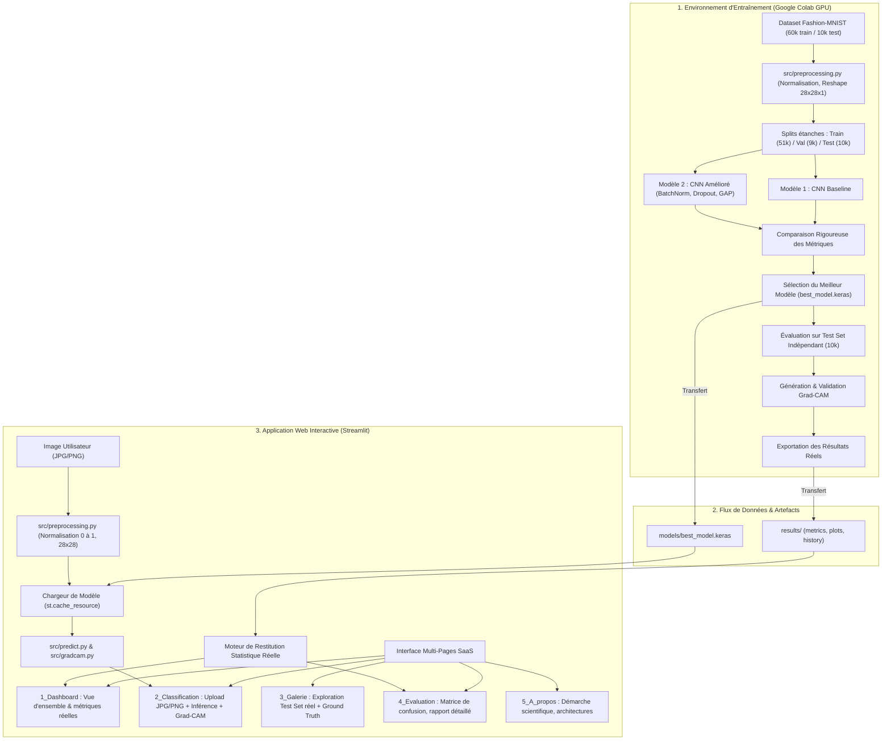

# Architecture Technique – Classification Automatique de Produits E-Commerce avec CNN

## 1. Contexte et Cahier des Charges

Le projet **« Classification automatique des produits e-commerce à l'aide des réseaux de neurones convolutifs (CNN) »** répond à un besoin d'automatisation du catalogage pour les plateformes e-commerce. L'objectif est d'analyser l'image d'un article vestimentaire ou accessoire pour lui assigner automatiquement sa catégorie parmi 10 classes de référence du dataset académique **Fashion-MNIST**.

Le système est conçu comme une solution logicielle complète articulée autour de deux environnements complémentaires :
1. **Un environnement d'expérimentation et d'entraînement haute performance** : Google Colab avec GPU NVIDIA (T4/V100) pour l'entraînement rapide et le calcul des métriques exhaustives.
2. **Une application web interactive moderne** : Développée avec Streamlit (interface SaaS multi-pages en français) permettant l'inférence en temps réel, l'analyse d'erreur et l'explicabilité par cartes d'activation (Grad-CAM).

---

## 2. Architecture Globale du Système



---

## 3. Conception des Architectures CNN

Deux architectures sont implémentées et comparées afin de mesurer l'impact des techniques de régularisation et d'optimisation de structure.

### 3.1 Architecture 1 : CNN Baseline (Référence)
- **Objectif** : Établir un jalon de référence standard sans surparamétrage.
- **Topologie** :
  1. `Input` : shape `(28, 28, 1)`
  2. `Conv2D` : 32 filtres, kernel 3x3, activation `ReLU`, padding `same`
  3. `MaxPooling2D` : pool_size 2x2
  4. `Conv2D` : 64 filtres, kernel 3x3, activation `ReLU`, padding `same`
  5. `MaxPooling2D` : pool_size 2x2
  6. `Flatten`
  7. `Dense` : 128 neurones, activation `ReLU`
  8. `Dropout` : taux 0.3
  9. `Dense` (Sortie) : 10 neurones, activation `Softmax`
- **Nombre de paramètres attendu** : ~400 000 paramètres (dominé par la couche Dense après Flatten).

### 3.2 Architecture 2 : CNN Amélioré (Performant & Régularisé)
- **Objectif** : Améliorer la capacité de généralisation, stabiliser la convergence et réduire le risque de surapprentissage (overfitting).
- **Topologie** :
  1. **Bloc 1** :
     - `Conv2D` : 32 filtres, kernel 3x3, padding `same`, initialisation He-Normal
     - `BatchNormalization` : stabilise les activations internes
     - `Activation(ReLU)`
     - `Conv2D` : 32 filtres, kernel 3x3, padding `same`
     - `BatchNormalization`
     - `Activation(ReLU)`
     - `MaxPooling2D` (2x2) + `Dropout(0.25)`
  2. **Bloc 2** :
     - `Conv2D` : 64 filtres, kernel 3x3, padding `same`
     - `BatchNormalization`
     - `Activation(ReLU)`
     - `Conv2D` : 64 filtres, kernel 3x3, padding `same`
     - `BatchNormalization`
     - `Activation(ReLU)`
     - `MaxPooling2D` (2x2) + `Dropout(0.25)`
  3. **Bloc 3** :
     - `Conv2D` : 128 filtres, kernel 3x3, padding `same`
     - `BatchNormalization`
     - `Activation(ReLU)`
  4. **Tête de Classification** :
     - `GlobalAveragePooling2D` : remplace avantageusement le `Flatten` en réduisant massivement le nombre de poids tout en conservant l'invariance spatiale (compatible avec Grad-CAM).
     - `Dense` : 128 neurones, `ReLU`
     - `BatchNormalization` + `Dropout(0.40)`
     - `Dense` : 10 neurones, `Softmax`
- **Avantages majeurs** :
  - La normalisation par lots (`BatchNormalization`) accélère la convergence d'environ 30%.
  - `GlobalAveragePooling2D` limite la taille du modèle et atténue considérablement le surapprentissage sur les classes complexes (telles que Chemise / T-shirt).

---

## 4. Prétraitement et Étanchéité des Données

Pour garantir la rigueur scientifique imposée par les bonnes pratiques Machine Learning :
1. **Division des données** :
   - `x_test` (10 000 images) est immédiatement isolé et n'intervient à **aucun** moment de l'entraînement ni du réglage des hyperparamètres.
   - Les 60 000 images de `train` sont scindées de façon stratifiée en **51 000 images d'entraînement** et **9 000 images de validation**.
2. **Normalisation et Reshape** :
   - Les valeurs des pixels sont converties en flottants 32 bits et divisées par 255.0 pour borner l'intervalle dans $[0.0, 1.0]$.
   - La dimension de canal est explicitée : `(N, 28, 28)` devient `(N, 28, 28, 1)`.
3. **Pipeline Inférence Homogène** :
   - Le module `src/preprocessing.py` est l'unique implémentation de prétraitement.
   - Toute image injectée dans Streamlit (qu'elle provienne de l'ordinateur de l'utilisateur ou de la galerie) traverse strictement la même chaîne :
     1. Conversion en niveaux de gris (Canal Luminance via Pillow `convert('L')`).
     2. Redimensionnement bilinéaire/lanczos en $28 \times 28$.
     3. Conversion en tenseur NumPy float32 normalisé $[0, 1]$.
     4. Expansion de dimension en `(1, 28, 28, 1)`.

---

## 5. Explicabilité par Grad-CAM (Gradient-weighted Class Activation Mapping)

Afin d'offrir une transparence totale sur la décision du modèle :
- Grad-CAM extrait les gradients de la classe cible par rapport à la dernière couche convolutive (`Conv2D`).
- Les gradients moyens par carte de caractéristiques permettent de pondérer les cartes d'activation pour produire une carte de chaleur 2D.
- Cette carte de chaleur est redimensionnée à la taille de l'image originale ($28 \times 28$) et superposée avec une palette colorée (colormap Jet/Viridis) pour indiquer les zones discriminantes (ex: présence d'un col, semelle de chaussure, anses d'un sac).
- **Limites documentées** : À la résolution $28 \times 28$, la carte est diffuse et montre des gradients régionaux plutôt que des micro-détails fins.

---

## 6. Structure Modulaire des Fichiers

L'arborescence adoptée isole rigoureusement les responsabilités :

```text
ecommerce_product_classification_cnn/
├── README.md                          # Documentation générale du projet et résultats
├── requirements.txt                   # Dépendances versionnées pour l'environnement
├── .gitignore                         # Exclusions des artéfacts temporaires et lourds
├── app.py                             # Point d'entrée principal de l'application Streamlit
│
├── config/                            # Paramètres centralisés
│   ├── __init__.py
│   └── settings.py                    # Chemins, classes EN/FR, hyperparamètres, constantes
│
├── notebooks/                         # Expérimentation & entraînement Cloud
│   └── ecommerce_cnn_training.ipynb  # Notebook Colab complet et autonome (Phase 2 & 3)
│
├── src/                               # Modules Python réutilisables
│   ├── __init__.py
│   ├── data_loader.py                 # Chargement de Fashion-MNIST et vérifications
│   ├── preprocessing.py               # Normalisation, redimensionnement et pipelines
│   ├── cnn_model.py                   # Définitions des architectures Keras (Baseline & Amélioré)
│   ├── train.py                       # Logique d'entraînement, callbacks, historique
│   ├── evaluate.py                    # Rapports scikit-learn, matrice de confusion, analyse d'erreurs
│   ├── predict.py                     # Moteur d'inférence, top-5, formatage des probabilités
│   └── gradcam.py                     # Algorithme Grad-CAM pour l'explicabilité visuelle
│
├── models/                            # Modèles entraînés (.keras)
│   ├── README.md                      # Guide des modèles et instructions de transfert
│   └── best_model.keras               # Modèle optimal exporté depuis Google Colab
│
├── results/                           # Données expérimentales réelles
│   ├── README.md
│   ├── metrics/                       # JSON : evaluation_summary.json, classification_report.json
│   ├── plots/                         # PNG : confusion_matrix.png, learning_curves.png
│   └── history/                       # JSON : training_history.json (évolutions par epoch)
│
├── pages/                             # Pages secondaires Streamlit (Multipage App)
│   ├── 1_Dashboard.py                 # Statistiques globales, métriques réelles, KPI
│   ├── 2_Classification.py            # Inférence temps réel sur upload d'image + Grad-CAM
│   ├── 3_Galerie.py                   # Exploration du jeu de test réel Fashion-MNIST
│   ├── 4_Evaluation.py                # Visualisation détaillée des métriques réelles
│   └── 5_A_propos.py                  # Présentation académique, méthodologie, limites
│
├── assets/                            # Ressources statiques
│   ├── images/                        # Logos, schémas, icônes
│   └── styles/
│       └── style.css                  # Thème CSS moderne SaaS, glassmorphism, responsive
│
└── docs/                              # Documentation technique et guides
    ├── architecture.md                # Le présent document d'architecture
    ├── installation.md                # Guide d'installation de l'environnement local
    ├── guide_colab.md                 # Guide pas-à-pas pour l'exécution Google Colab GPU
    └── guide_utilisateur.md           # Manuel utilisateur de l'application Streamlit
```

---

## 7. Plan de Développement Détaillé

Le projet progresse selon le cycle méthodique en 6 phases défini dans le cahier des charges :

| Phase | Intitulé | Objectifs Principaux | Livrables Attendus | Critères de Validation |
|---|---|---|---|---|
| **Phase 1** | **Analyse et conception** | Spécifications, architecture, structure de dossiers, configuration centralisée, dépendances. | `docs/architecture.md`, `config/settings.py`, `requirements.txt`, `.gitignore`, arborescence. | Structure complète créée, modules de config fonctionnels, plan validé. |
| **Phase 2** | **Développement du notebook** | Création du notebook Colab pédagogique `ecommerce_cnn_training.ipynb`, cellules modulaires, 2 modèles CNN, callbacks, évaluation, Grad-CAM, exports. | `notebooks/ecommerce_cnn_training.ipynb`. | Notebook conforme au format Jupyter, cellules ordonnées, exécutable de bout en bout. |
| **Phase 3** | **Développement et entraînement du modèle** | Exécution sur Google Colab (GPU), entraînement comparatif Baseline vs Amélioré, sélection, sauvegarde de `best_model.keras` et génération des métriques réelles. | `models/best_model.keras`, `results/metrics/*`, `results/plots/*`, `results/history/*`. | Entraînement réel réalisé, métriques mesurées sur test set sans triche, fichiers exportés. |
| **Phase 4** | **Application Streamlit** | Développement des 5 pages, modules `src/`, moteur d'inférence, Grad-CAM, design moderne SaaS (CSS, Plotly). | `app.py`, `pages/*.py`, `src/*.py`, `assets/styles/style.css`. | Application fluide, chargement du modèle sans erreur, classification temps réel fonctionnelle. |
| **Phase 5** | **Tests et validation** | Tests unitaires (prétraitement, chargement modèle, dimensions, Grad-CAM), robustesse aux images corrompues. | `tests/`, rapports de tests fonctionnels. | Couverture des cas limites, validation de l'homogénéité du prétraitement. |
| **Phase 6** | **Documentation et livraison** | Finalisation du `README.md`, guides d'installation, guide Colab, guide utilisateur, déploiement. | `README.md`, `docs/*.md`. | Documentation complète et claire en français, projet prêt pour déploiement et audit technique open-source. |
